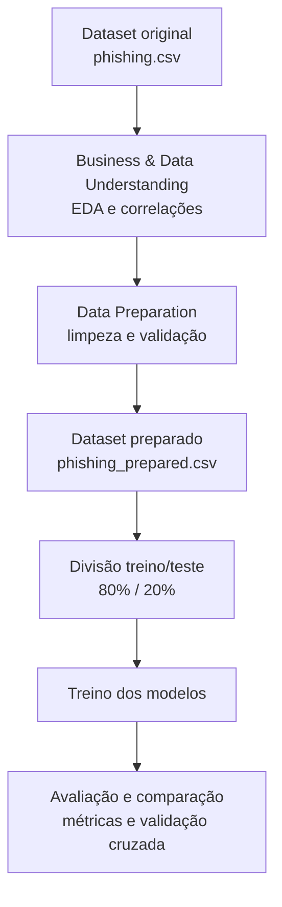

<div align="center">

# 🛡️ Phishing Website Detector

### Classificação de websites legítimos e de phishing com Machine Learning

Projeto académico desenvolvido no âmbito da unidade curricular **Inteligência Artificial Aplicada à Cibersegurança (IAAC)** — ISTEC.

**Autor:** Diogo Carvalho


-20808D)

</div>

---

## 📌 Índice

- [Visão geral](#-visão-geral)
- [Objetivos](#-objetivos)
- [Metodologia e pipeline](#-metodologia-e-pipeline)
- [Dados](#-dados)
- [Modelos e avaliação](#-modelos-e-avaliação)
- [Estrutura do projeto](#-estrutura-do-projeto)
- [Instalação](#-instalação)
- [Como executar](#-como-executar)
- [Notebooks](#-notebooks)
- [Limitações e trabalho futuro](#-limitações-e-trabalho-futuro)
- [Referências](#-referências)
- [Licença](#-licença)

---

## 🎯 Visão geral

O **Phishing Website Detector** é um projeto de Machine Learning que estuda a classificação de websites como **phishing** ou **legítimos**, com base em características já extraídas de cada website. O objetivo é perceber até que ponto diferentes algoritmos conseguem distinguir padrões associados a páginas potencialmente fraudulentas.

O projeto cobre o ciclo de trabalho de um problema de aprendizagem automática: compreensão do contexto, exploração dos dados, preparação do dataset, treino dos modelos e avaliação dos resultados. Foi organizado tendo como referência a metodologia **CRISP-ML(Q)**.

> **Importante:** este repositório é um projeto académico e experimental. Não visita URLs nem inspeciona websites em tempo real. A classificação depende exclusivamente das características presentes no dataset e não deve ser utilizada, isoladamente, para decidir se um website é seguro.

## 🎯 Objetivos

- Compreender o problema de phishing do ponto de vista de negócio e cibersegurança.
- Explorar a estrutura, a distribuição e as relações existentes nos dados.
- Preparar o dataset, identificando duplicados e perfis com rótulos contraditórios.
- Treinar e comparar vários algoritmos de classificação.
- Avaliar os modelos com métricas complementares, validação cruzada e análise de possível overfitting.
- Identificar características que mais contribuem para as previsões.

## 🔄 Metodologia e pipeline

O trabalho está dividido em três fases principais:

1. **Business & Data Understanding** — definição do problema, análise exploratória (EDA), distribuição das classes e estudo das correlações.
2. **Data Preparation** — remoção de colunas não preditivas, análise de valores em falta, identificação de registos contraditórios, remoção de duplicados e preparação do conjunto final.
3. **Model Building** — divisão estratificada entre treino e teste, treino dos classificadores, avaliação e comparação dos resultados.



## 🗂️ Dados

O projeto inclui um dataset original e uma versão preparada:

| Ficheiro | Descrição |
|---|---|
| `dataset/phishing.csv` | Dataset original utilizado na exploração e preparação |
| `dataset/phishing_prepared.csv` | Dataset após as operações de preparação |

O dataset original contém **11.054 registos e 32 colunas**: uma coluna de índice, 30 características e a variável-alvo `class`. As características estão maioritariamente codificadas com `-1`, `0` e `1`, representando diferentes sinais observados nos websites.

### Preparação dos dados

As operações implementadas incluem:

- Remoção da coluna `Index`, por não ser uma característica preditiva.
- Verificação de valores em falta.
- Identificação de combinações de características associadas a classes diferentes.
- Remoção dos registos pertencentes a perfis contraditórios.
- Remoção de registos duplicados.
- Análise exploratória de valores extremos e de features correlacionadas.
- Divisão estratificada treino/teste, com 80% para treino e 20% para teste.

De acordo com a análise documentada no projeto, a preparação reduz o dataset para **5.721 registos e 31 colunas** (30 características e a classe). As características são mantidas na sua escala original, uma vez que já utilizam valores comparáveis; não é aplicado scaling.

**Codificação da classe:** no dataset, `-1` representa *phishing* e `1` representa *legítimo*. Nos scripts de modelação, os valores são convertidos para `0` (*phishing*) e `1` (*legítimo*) para compatibilidade com o XGBoost.

## 🤖 Modelos e avaliação

São considerados quatro classificadores:

| Modelo | Papel no projeto |
|---|---|
| **Logistic Regression** | Modelo de referência (*baseline*) |
| **Decision Tree** | Classificador baseado em regras de decisão |
| **Random Forest** | Conjunto de árvores de decisão |
| **XGBoost** | Modelo de boosting baseado em árvores |

A avaliação implementada contempla:

- **Accuracy** — proporção global de previsões corretas.
- **Precision, Recall e F1-score** — análise complementar do desempenho por classe.
- **ROC AUC e PR AUC** — avaliação da capacidade de separação das classes.
- **Matriz de confusão** — identificação dos tipos de erro.
- **Validação cruzada estratificada de 5 folds** — análise da consistência no conjunto de treino.
- **Comparação entre treino e teste** — verificação de possíveis sinais de overfitting.
- **Importância das características** — identificação das variáveis mais relevantes nos modelos que disponibilizam essa informação.

### Resultados de referência

A versão anterior da análise do projeto reporta os seguintes resultados no conjunto de teste:

| Modelo | Accuracy | ROC AUC |
|---|---:|---:|
| Logistic Regression | 92,14% | 0,9773 |
| Decision Tree | 93,71% | 0,9764 |
| Random Forest | 94,59% | 0,9892 |
| **XGBoost** | **96,94%** | **0,9952** |

Estes valores devem ser interpretados no contexto do dataset e da divisão de treino/teste utilizada. A classe positiva nas métricas padrão dos scripts é **legítimo** (`1`); por isso, ao avaliar o risco de segurança, é especialmente importante observar também o *recall* da classe phishing (`0`) e o número de páginas de phishing classificadas incorretamente como legítimas.

O script `models/modeling.py` imprime no terminal as métricas detalhadas e a comparação dos modelos. Os números acima são resultados de referência documentados no projeto e podem variar se o dataset, as dependências ou a configuração forem alterados.

## 📁 Estrutura do projeto

```text
IAAC-Projeto-Diogo-Carvalho/
├── Business_Understanding/
│   ├── Business and Data Understanding - Phishing Website Detector.docx
│   ├── Machine Learning Canvas DiogoCarvalho.docx.pdf
│   └── EAD_phishing.py
├── Data_Preparation/
│   ├── Data Preparation — Phishing Website Detector.docx
│   └── data_preparation.py
├── dataset/
│   ├── phishing.csv
│   └── phishing_prepared.csv
├── models/
│   ├── Model_Building_Phishing.docx
│   ├── modeling.py
│   ├── optimize_xgboost.py
│   └── xgboost_tuning_results.json
├── notebooks/
│   ├── data_understanding.ipynb
│   ├── data_preparation.ipynb
│   └── model_building.ipynb
├── src/
│   ├── __init__.py
│   ├── data_preparation_utils.py
│   ├── eda_utils.py
│   └── model_utils.py
├── requirements.txt
├── LICENSE
└── README.md
```

### Principais componentes

- `Business_Understanding/EAD_phishing.py` — exploração inicial, estatísticas descritivas, correlações e gráficos.
- `Data_Preparation/data_preparation.py` — execução das etapas de preparação e gravação do dataset preparado.
- `models/modeling.py` — treino e avaliação dos quatro classificadores.
- `models/optimize_xgboost.py` — pesquisa aleatória de hiperparâmetros para o XGBoost, com validação cruzada e seleção orientada para o *recall* de phishing.
- `notebooks/` — exploração e execução faseada do trabalho em Jupyter.
- `src/` — funções utilitárias reutilizadas pelos scripts e notebooks.

## ⚙️ Instalação

### Requisitos

- Python **3.10 ou superior** (recomendado).
- `pip`.
- Ambiente virtual recomendado para isolar as dependências.

### 1. Obter o projeto

Se estiver disponível num repositório Git:

```bash
git clone <URL-DO-REPOSITORIO>
cd IAAC-Projeto-Diogo-Carvalho
```

Em alternativa, extrai o ZIP do projeto e abre um terminal na pasta `IAAC-Projeto-Diogo-Carvalho`.

### 2. Criar e ativar o ambiente virtual

**Windows — PowerShell**

```powershell
python -m venv .venv
.\.venv\Scripts\Activate.ps1
```

**Windows — CMD**

```bat
python -m venv .venv
.venv\Scripts\activate.bat
```

**Linux / macOS**

```bash
python3 -m venv .venv
source .venv/bin/activate
```

### 3. Instalar dependências

```bash
python -m pip install --upgrade pip
pip install -r requirements.txt
```

As dependências principais incluem Pandas, Matplotlib, Seaborn, scikit-learn, XGBoost, Joblib e Jupyter.

## ▶️ Como executar

Executa os comandos a partir da **raiz do projeto**.

### 1. Análise exploratória

```bash
python Business_Understanding/EAD_phishing.py
```

Carrega o dataset original, apresenta estatísticas e distribuições e gera visualizações de análise exploratória.

### 2. Preparação dos dados

```bash
python Data_Preparation/data_preparation.py
```

Executa as verificações e operações de limpeza e grava o dataset preparado em `dataset/phishing_prepared.csv`.

> Este passo reescreve o ficheiro preparado. Se quiseres preservar a versão atual, faz uma cópia antes de executar.

### 3. Treino e avaliação dos modelos

```bash
python models/modeling.py
```

Treina os quatro modelos, calcula as métricas de avaliação, executa validação cruzada e apresenta os resultados no terminal.

### 4. Otimização do XGBoost (opcional)

```bash
python models/optimize_xgboost.py
```

Executa `RandomizedSearchCV` com validação cruzada estratificada e guarda os resultados em `models/xgboost_tuning_results.json`. Esta etapa pode demorar mais tempo, porque avalia várias combinações de hiperparâmetros.

### 5. Executar os notebooks

```bash
jupyter notebook
```

Abre a pasta `notebooks/` e executa os notebooks pela ordem recomendada:

1. `data_understanding.ipynb`
2. `data_preparation.ipynb`
3. `model_building.ipynb`

Segue as instruções de cada notebook e confirma o diretório de trabalho caso ocorram erros nos imports.

## ⚠️ Limitações e trabalho futuro

### Limitações conhecidas

- O sistema trabalha com características já presentes no dataset; não recolhe dados de URLs nem analisa websites em tempo real.
- Os resultados dependem da representatividade e qualidade do dataset.
- A remoção de duplicados e de perfis contraditórios reduz consideravelmente o número de exemplos disponíveis.
- A avaliação offline não garante o mesmo desempenho perante campanhas novas, técnicas de evasão ou alterações nos padrões de phishing.
- A classe considerada positiva nas métricas padrão é a classe legítima; a análise de segurança deve destacar explicitamente o desempenho na classe phishing.
- A otimização de hiperparâmetros é uma experiência adicional e deve ser avaliada no conjunto de teste reservado, sem o utilizar durante a seleção dos parâmetros.

### Próximas melhorias

- [ ] Criar uma interface para introdução de características e apresentação da previsão.
- [ ] Integrar extração controlada de características de URLs, com salvaguardas de segurança.
- [ ] Avaliar os modelos em dados mais recentes e independentes.
- [ ] Ajustar o limiar de decisão para reduzir falsos negativos de phishing.
- [ ] Comparar métricas por classe e analisar os custos dos diferentes tipos de erro.
- [ ] Investigar interpretabilidade e estabilidade das características mais importantes.
- [ ] Automatizar a geração de relatórios e gráficos de avaliação.

## 📚 Referências

- Mohammad, R. M., Thabtah, F. e McCluskey, L. — investigação sobre deteção de websites de phishing e conjunto de dados associado.
- [Kaggle — Phishing Website Detector](https://www.kaggle.com/datasets/eswarchandt/phishing-website-detector)
- [Documentação do scikit-learn](https://scikit-learn.org/stable/)
- [Documentação do XGBoost](https://xgboost.readthedocs.io/)

## 📄 Licença

O projeto inclui um ficheiro `LICENSE` com condições de utilização proprietárias. A consulta do código não concede automaticamente autorização para o copiar, modificar, distribuir ou alojar. Consulta o ficheiro `LICENSE` e contacta os titulares dos direitos para obter autorização.

---

<div align="center">

**Projeto académico · Inteligência Artificial Aplicada à Cibersegurança**

Desenvolvido por Diogo Carvalho e equipa.

</div>
