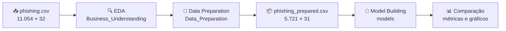

<div align="center">

# 🎣 Phishing Website Detector

**Deteção de websites de phishing com Machine Learning, seguindo a metodologia CRISP-ML(Q)**


-20808D)


*Projeto da unidade curricular **Inteligência Artificial Aplicada à Cibersegurança** — ISTEC · Autor: Diogo Carvalho*

</div>

---

## 📑 Índice

- [Sobre o projeto](#-sobre-o-projeto)
- [Pipeline](#-pipeline)
- [Dataset](#-dataset)
- [Resultados](#-resultados)
- [Estrutura do repositório](#-estrutura-do-repositório)
- [Como executar](#-como-executar)
- [Limitações](#-limitações)
- [Próximos passos](#-próximos-passos)
- [Referências](#-referências)
- [Licença](#-licença)

---

## 🎯 Sobre o projeto

Websites de phishing enganam utilizadores, roubam credenciais e causam perdas financeiras, e a análise manual de sites suspeitos não escala. Este projeto constrói um **protótipo de apoio à decisão** que classifica um website como **legítimo** ou **phishing** a partir de **30 características** extraídas do URL, do domínio e do conteúdo da página.

**Quem beneficia:** analistas de cibersegurança, equipas SOC e administradores de sistemas que precisam de uma primeira triagem de sites suspeitos.

**O que o projeto cobre:**

- Compreensão do problema e dos dados (Business & Data Understanding + Machine Learning Canvas)
- Análise exploratória (EDA) com correlações de Pearson e Spearman
- Preparação dos dados (limpeza, perfis contraditórios, duplicados, split estratificado)
- Treino e comparação de **4 modelos**: Logistic Regression (baseline), Decision Tree, Random Forest e XGBoost
- Avaliação com Accuracy, Precision, Recall, F1, ROC AUC, PR AUC, matriz de confusão, cross-validation 5-fold e verificação de overfitting

> ⚠️ A classificação é uma **ferramenta de apoio**, não uma garantia de segurança. Um site classificado como legítimo não deve ser automaticamente considerado seguro.

---

## 🔄 Pipeline



---

## 🗂️ Dataset

Dataset público **Phishing Website Detector** (Kaggle), baseado no trabalho de Mohammad, Thabtah e McCluskey (2015). Todas as features estão codificadas em `-1` (suspeito), `0` (moderado) e `1` (legítimo); `WebsiteForwarding` usa apenas `0` e `1`.

| Etapa | Resultado |
|-------|-----------|
| Dataset original | 11.054 registos × 32 colunas (Index + 30 features + `class`) |
| Distribuição original | 55,7% legítimos · 44,3% phishing |
| Valores em falta | 0 |
| Remoção da coluna `Index` | 11.054 × 31 |
| Perfis contraditórios removidos | 64 perfis (357 registos) |
| Duplicados removidos | 4.976 |
| **Dataset preparado** | **5.721 × 31** (51,65% phishing · 48,35% legítimo) |
| Treino / Teste | 4.576 (80%) / 1.145 (20%), estratificado, `random_state=42` |
| Scaling | Não aplicado (features já em `[-1, 0, 1]`) |

**Features mais associadas à classe (Pearson):** `HTTPS` (0,71) · `AnchorURL` (0,69) · `PrefixSuffix-` (0,35) · `WebsiteTraffic` (0,35)

**Pares muito correlacionados (|r| ≥ 0,80, mantidos por agora):** `UsingPopupWindow`↔`Favicon` (0,93) · `Redirecting//`↔`ShortURL` (0,81) · `NonStdPort`↔`Favicon` (0,81)

---

## 📊 Resultados

Avaliação no conjunto de teste (1.145 websites: 591 phishing e 554 legítimos).

| Modelo | Accuracy | F1 | ROC AUC | PR AUC | Phishing não detetado | Legítimos bloqueados | Recall (phishing) |
|--------|:--------:|:--:|:-------:|:------:|:---------------------:|:--------------------:|:-----------------:|
| Logistic Regression *(baseline)* | 0,9214 | 0,9204 | 0,9773 | 0,9769 | 56 | 34 | 90,5% |
| Decision Tree | 0,9371 | 0,9355 | 0,9764 | 0,9655 | 40 | 32 | 93,2% |
| Random Forest | 0,9459 | 0,9451 | 0,9892 | 0,9888 | 42 | 20 | 92,9% |
| **XGBoost** 🏆 | **0,9694** | **0,9688** | **0,9952** | **0,9949** | **24** | **11** | **95,9%** |

> **Nota sobre as métricas:** Precision, Recall e F1 calculados pelo scikit-learn usam a classe `1` (**Legítimo**) como positiva. Por isso a tabela mostra à parte o que importa para a deteção de phishing: quantos phishing escaparam e a taxa de deteção da classe phishing. A tabela completa está em [`models/comparacao_modelos.csv`](models/comparacao_modelos.csv).

**Cross-validation (5-fold, treino):** XGBoost 96,29% ± 0,50% de accuracy, Random Forest 94,91% ± 0,99%, Decision Tree 93,51% ± 0,71%, Logistic Regression 93,27% ± 0,93%.

**Overfitting:** a diferença treino/teste fica abaixo de 2,5 pontos percentuais em todos os modelos (o maior valor é o do XGBoost, 2,31 p.p.).

**Features mais importantes:** `HTTPS`, `AnchorURL` e `PrefixSuffix-` lideram nos modelos de árvores e no XGBoost, em linha com a análise de correlação.

<div align="center">


 

 

</div>

Mais gráficos (precision, recall, F1 e importância de features dos restantes modelos) em [`models/graficos/`](models/graficos/).

---

## 📁 Estrutura do repositório

```
IAAC-Projeto-Diogo-Carvalho/
├── Business_Understanding/
│   ├── Business and Data Understanding - Phishing Website Detector.docx
│   ├── Machine Learning Canvas DiogoCarvalho.docx.pdf
│   └── EAD_phishing.py            # EDA em script
├── Data_Preparation/
│   ├── Data Preparation — Phishing Website Detector.docx
│   └── data_preparation.py        # gera dataset/phishing_prepared.csv
├── dataset/
│   ├── phishing.csv               # original (11.054 × 32)
│   └── phishing_prepared.csv      # preparado (5.721 × 31)
├── models/
│   ├── Model_Building_Phishing.docx
│   ├── modeling.py                # treina e avalia os 4 modelos (saída no terminal)
│   ├── gerar_graficos.py          # gera gráficos e comparacao_modelos.csv
│   ├── comparacao_modelos.csv
│   └── graficos/                  # matrizes, ROC, PR, importâncias, comparações
├── notebooks/
│   ├── data_understanding.ipynb
│   ├── data_preparation.ipynb
│   └── model_building.ipynb
├── src/
│   ├── eda_utils.py               # funções de EDA
│   ├── data_preparation_utils.py  # funções de preparação
│   └── model_utils.py             # modelos, métricas e gráficos
├── requirements.txt
├── LICENSE
└── README.md
```

---

## 🚀 Como executar

### 1. Preparar o ambiente

```bash
git clone <url-do-repositório>
cd IAAC-Projeto-Diogo-Carvalho

python -m venv .venv
# Windows
.venv\Scripts\activate
# Linux / macOS
source .venv/bin/activate

pip install -r requirements.txt
```

### 2. Correr as fases (por ordem)

| Fase | Comando | O que faz |
|------|---------|-----------|
| EDA | `python Business_Understanding/EAD_phishing.py` | Estatísticas, correlações e gráficos do dataset original |
| Data Preparation | `python Data_Preparation/data_preparation.py` | Limpa os dados e regrava `dataset/phishing_prepared.csv` |
| Model Building | `python models/modeling.py` | Treina, avalia e compara os 4 modelos (resultados no terminal) |
| Gráficos | `python models/gerar_graficos.py` | Gera `models/comparacao_modelos.csv` e `models/graficos/*.png` |

Os scripts usam caminhos relativos ao próprio ficheiro, por isso podem ser executados a partir de qualquer pasta.

### 3. Notebooks

```bash
jupyter notebook notebooks/
```

Abre `data_understanding`, `data_preparation` e `model_building` pela ordem. Os notebooks devem ser executados a partir da pasta `notebooks/`, porque importam os módulos de `../src`.

> Os resultados são **reprodutíveis** (`random_state=42` em todo o pipeline).

---

## ⚠️ Limitações

- O modelo usa apenas as 30 características do dataset; **não acede aos websites em tempo real** nem analisa conteúdo dinâmico.
- Os hiperparâmetros são **pré-definidos**, sem otimização sistemática, pelo que os resultados são uma primeira referência (baseline).
- Um bom desempenho neste dataset não garante capacidade de detetar todas as variantes de phishing, existentes ou futuras.
- Depois da limpeza ficam 5.721 registos únicos, um conjunto de teste relativamente pequeno (1.145).
- O resultado depende muito de poucas features (`HTTPS`, `AnchorURL`, `PrefixSuffix-`).

---

## 🔭 Próximos passos

- [ ] Otimização de hiperparâmetros (`GridSearchCV` / `RandomizedSearchCV`)
- [ ] Avaliar o impacto de remover features altamente correlacionadas
- [ ] Analisar a dependência do modelo nas features mais importantes
- [ ] Protótipo funcional: receber as características de um website e devolver a classificação
- [ ] Ajustar o limiar de decisão para privilegiar a deteção de phishing

---

## 📚 Referências

- Mohammad, Thabtah e McCluskey (2015) — trabalho em que o dataset se baseia
- [Kaggle — Phishing Website Detector](https://www.kaggle.com/datasets/eswarchandt/phishing-website-detector)
- [GeeksforGeeks — Machine Learning Tutorial](https://www.geeksforgeeks.org/machine-learning/machine-learning-tutorial/)

---

## 📄 Licença

© 2026 Diogo Teixeira Carvalho, José Maria Machado Alves e Tomás Maio Matos. Todos os direitos reservados.

Software proprietário e confidencial. O código pode ser consultado para fins educativos, mas **não pode ser executado, modificado, alojado ou redistribuído** sem autorização escrita dos titulares. Ver [LICENSE](LICENSE).
